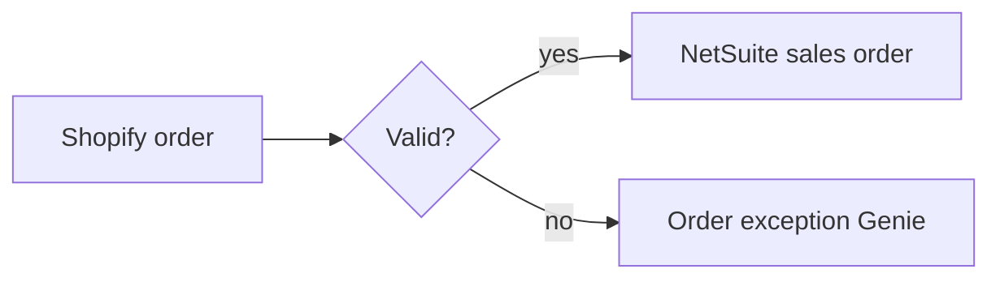

# Rich content for marketplace pages

What the `body` field of `marketplace_profile_save` and `marketplace_templates_save` takes: Markdown
with tables, images, and three kinds of block. A template's body shows as a "Details" section after
its overview. A profile's body shows as a "Profile" section. The text of every block also reaches
agents that read the page as Markdown, so write each block so the content is clear without the picture.

## Rules for the body

- Use `##` and `###` headings. A single `#` is shown as `##`.
- Raw HTML is not supported: it is shown as plain text.
- Limits: 100 KB, 20 images, 12 blocks.
- The marketplace checks the body before the person is asked to confirm. A refusal lists every
  problem with its block and line: fix them all, then save again.
- An empty `body` removes it.
- To try a draft without saving it, call `marketplace_body_check`. For the current block schemas and examples,
  call `marketplace_options_get` (the `body.blocks` part): it is always the version the marketplace enforces.

## Choose the block

| Need | Use | Why |
| --- | --- | --- |
| Architecture or flow: which apps and resources connect, and how | `diagram` | Matches the page design and reads as text for agents |
| Numbers over time or across categories | `chart` | Drawn from data you give; no image to maintain |
| A flow with branches, a sequence of calls, a data model | `mermaid` | Layout is automatic, so it fits shapes a row of boxes cannot |
| A list of resources, a comparison | Markdown table | Plain and readable by agents |
| A screenshot or photo | Image | Only when the picture is the content |

## diagram

A fenced block with the language `diagram`, written in YAML. Boxes sit in rows, left to right, joined by arrows.

```diagram
caption: The sync moves records. The workflow decides where each order goes.
nodes:
  shopify: {type: app, icon: shopify, title: Shopify, meta: "orders · customers"}
  sync: {type: sync, eyebrow: Two-Way Sync, title: Order sync, meta: "every 5 minutes · 31 field mappings"}
  netsuite: {type: app, icon: netsuite, title: NetSuite, meta: "sales_order · customer"}
  router: {type: workflow, eyebrow: "Workflow · on new order", title: Order router}
  exceptions: {type: genie, eyebrow: "Genie · on failed validation", title: Order exception Genie}
rows:
  - [shopify, "<->", sync, "<->", netsuite]
  - [router, "->", exceptions]
```

| Part | What to write |
| --- | --- |
| `caption` | One or two sentences under the diagram: what it shows |
| `nodes` | Optional. Boxes you name once and use by id in `rows` |
| `rows` | 1 to 8 rows; each row is a list of up to 7 items, a node id, an inline node, or a connector |
| Connectors | `->`, `<-`, `<->`, `---`. Always in quotes. Each sits between two boxes |
| Node `title` | Required, at most 80 characters: the resource or app name |
| Node `type` | `app`, `sync`, `workflow`, `genie`, `queue`, `playbook`, `database`, `person`, `external`, `note`. It sets the color; the default is a plain box |
| Node `eyebrow` | A small label above the title, such as the trigger |
| Node `meta` | A line in monospace: objects, counts, schedule |
| Node `icon` | A connector name such as `shopify` or `netsuite`, from the connectors the template lists |
| Node `href` | An `https://` link or a path that starts with `/` |
| Node `wide` | `true` to give the box more room in its row |

Match each type to the resource: `sync` for a Two-Way Sync, `workflow` for a workflow, `genie` for
a Genie, `queue` for an event queue, `app` for an external app, `database` for a database.

## chart

A fenced block with the language `chart`, written in YAML. It holds the data, never code.

```chart
type: bar
title: Orders synced per week
y_label: Orders
data:
  - {label: Week 1, value: 1200}
  - {label: Week 2, value: 1850}
  - {label: Week 3, value: 2400}
```

- `type` is one of `bar`, `grouped-bar`, `stacked-bar`, `line`, `area`, `pie`, `donut`.
- `data` has 1 to 200 points, each with `label` and `value`.
- `grouped-bar` and `stacked-bar` need a `series` on every point. `line` and `area` take `series` to draw several lines.
- `pie` and `donut` take `label` and `value` only, and no negative values.
- Use numbers the person can check. Say where they come from in `caption`.

## mermaid

A fenced block with the language `mermaid`. The first line names the diagram type: `flowchart`,
`sequenceDiagram`, `erDiagram`, `stateDiagram-v2`, `classDiagram`, `gantt`, `journey`, `timeline` or `mindmap`.



Directives (`%%{ }`), `click` lines and scripts are refused. Keep it under 6,000 characters.

## Images

- Write ``. The marketplace copies a public `https://`
  PNG, JPEG, WebP or SVG of at most 8 MB into its own storage when it saves the body. Links that
  start with `http://` or point to a private address are refused.
- An image with a public `https://` URL needs no tool: write it in the body.
- An image with no public URL, and small (about 3 MB or less): call `marketplace_body_upload_image` with
  `content_base64` and `content_type`.
- A file on the person's computer, or a larger one (up to 8 MB): call `marketplace_body_upload_link`. It returns a
  link valid for 15 minutes and 10 images. If you have a shell, run the returned `curl -T ./image.png '<url>'` line:
  the file goes straight to the marketplace and never passes through you. If you have no shell, give the person
  the link: they open it, drop the file, and send you the line it shows.
- Both upload routes answer a `markdown` line: paste it into the body as it is, then save the body.
  Pass `template_slug` for a template body, leave it empty for the profile body.
- The logo, icon and quote photo are not body images: set them with `marketplace_profile_set_image`.
- The alt text is the caption people see and the description an agent reads: say what the image shows.
- Never show credentials, customer names or record values in an image: the page is public.

## Tables

Use a Markdown table. The first row is the header.

```markdown
| Resource | Type | What it does |
| --- | --- | --- |
| Order sync | Two-Way Sync | Keeps orders consistent in both systems |
```

## Check it

1. Save the body. If the marketplace lists problems, fix every one and save again.
2. Open the template's or profile's `public_url`: a block that cannot be drawn shows its error in
   place, so a problem is visible rather than missing.
3. Show the person the page and wait for their approval before publishing.
